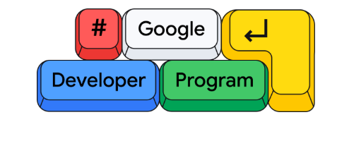

## Hi there 👋

- 🔭 I'm currently developing AI-powered application APIs, enabling intelligent automation, data analysis, and enhanced user experiences through seamless integration with Artificial Intelligence services.
https://github.com/fcantarelli/AI/tree/main/LLM_integration_Engineering

- 🌱 I’m currently learning about LLM services and how to integrate them with my APIs through an abstraction layer, enabling provider-agnostic and scalable AI solutions.

- 💬 Feel free to reach out about integration architectures, APIs, microservices, cloud platforms, or enterprise integrations. I’ll be glad to help and exchange ideas.

<!--
**fcantarelli/fcantarelli** is a ✨ _special_ ✨ repository because its `README.md` (this file) appears on your GitHub profile.

Here are some ideas to get you started:

- 🔭 I’m currently working on ...
- 🌱 I’m currently learning ...
- 👯 I’m looking to collaborate on ...
- 🤔 I’m looking for help with ...
- 💬 Ask me about ...
- 📫 How to reach me: ...
- 😄 Pronouns: ...
- ⚡ Fun fact: ...
-->
